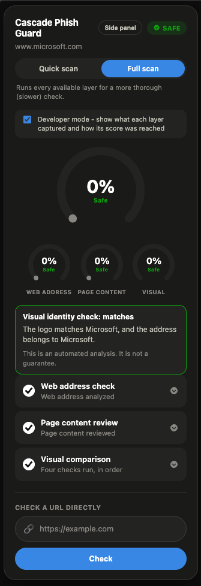

# Cascade Phish Guard

|                            |                                 |
| -------------------------- | ------------------------------- |
| **Batch**                  | BSc Hons in Computing 2024.2P   |
| **Module**                 | Dissertation and Project Artefact |
| **Coursework**             | Individual                      |
| **Student Name**           | B N D U Fernando                |
| **NIBM Student Index**     | COBSCCOMP24.2P-035              |
| **Coventry Student Index** | 16110658                        |

A three-layer phishing risk analysis system: a Chrome extension (Manifest V3) backed by
a local Python service. Each visited page is analyzed by up to three layers, which
produce a risk signal from available evidence (URL structure, page content, visual
identity) rather than a certain, binary detection - no externally observable analysis
can confirm a page operator's intent, so every verdict is phrased as a probability, never
a guarantee. Later layers run only when earlier ones leave the page uncertain (Full scan
runs all three).

Final-year research project. Nothing leaves the machine except the page address and the
images needed for the visual check: no form values are sent, and screenshots are not stored.

## The three layers

1. **Layer 1: web address.** An XGBoost model on address features (length, HTTPS, brand
   names in the address, edit distance to brand names, TLD risk, numeric-IP hosts,
   popularity rank, WHOIS age when available). Trained on 27,940 addresses.
2. **Layer 2: page content.** Runs in a headless browser on the rendered page: forms,
   password fields, external form actions, iframes, redirects, link ratios, and risk
   scores for embedded links. An XGBoost model on 22 features, trained on 1,784 captured
   pages (1,291 train, 229 validation, 264 test).
3. **Layer 3: visual identity.** Asks whether a page imitates a known brand. Sub-layers:
   - the logo on the page, compared with reference logos for 523 brands;
   - a brand named in the address;
   - a live comparison of the visited home page's logo with the brand's own home page;
   - alarming wording at the top of the page (provisional, not part of the verdict).

   A brand mismatch raises the verdict to "suspicious" only together with an input field or
   sign-in link on the page. Layer 3 never sets "phishing" alone and never lowers a verdict.

**Verdict:** the Layer 2 score when Layer 2 ran, otherwise Layer 1. Below 0.2 is safe,
above 0.8 is phishing, and anything between is suspicious.



## Results so far

- **Layer 1:** tested on 4,532 addresses (2,520 phishing, 2,012 legitimate).
- **Layer 2:** test F1 0.80 at a threshold chosen on validation data. Its score can
  move with what the page shows at scan time.
- **False alarms on 833 legitimate home pages:** 13 (1.6% of the 798 that loaded).
- **Metadata identity check:** tested and not used in the verdict (negative result; see
  `temp/writing/METADATA_NEGATIVE_RESULT.md`).
- **Region comparison:** demonstrated end to end against a controlled copycat page, in
  addition to false-match testing on unrelated pages.

Full evaluation, baseline comparison, and discussion of scope are reported in the
accompanying paper and dissertation rather than here.

## Project layout

```
backend/
  api/                 FastAPI routes (/analyze, /health, /version)
  app/
    features/          feature extraction (URL, DOM, brand hints, official domains, metadata)
    models/            trained model wrappers (Layer 1, Layer 2)
    services/          cascade, Layer 2 and Layer 3 analysers, reasons, region comparison
    schemas/           request and response models
extension/             Chrome extension (background, popup, logo finder, shared settings)
scripts/
  data_collection/     data sources
  data_filtering/      cleaning, feature building, splits
  training/            model training and comparison
  layer3/              page capture, logo cache, false-alarm and region tests
data/                  datasets, reports and models (git-ignored where large or sensitive)
temp/                  working notes, status documents and the report briefing
tests/                 unit and plumbing tests for each layer
```

## Setup

```bash
git clone <repo-url>
cd cascade-phish-guard
python3 -m venv .venv
source .venv/bin/activate
pip install -r requirements.txt
```

Layer 3's logo check also needs the reference model files in `data/external/phishpedia/`
(not in git) and PyTorch and torchvision.

## Running the backend and the extension

```bash
cd backend
export API_KEY="<the key in extension/shared.js>"
export ENABLE_LAYER2=true        # optional: runs Layer 2 on uncertain and Full-scan pages
../.venv/bin/uvicorn api.main:app --port 8000
```

Then in Chrome: `chrome://extensions`, turn on Developer mode, and click **Load unpacked**
on the `extension/` folder. Open a page and pick **Quick scan** (address only) or **Full scan**
(address, page content and visual identity). The popup also checks any pasted address,
without opening it, using the address layer only.

## Tests

```bash
.venv/bin/python tests/test_layer3_rule.py
.venv/bin/python tests/test_reasons.py
.venv/bin/python tests/test_layer3_background.py
.venv/bin/python tests/test_metadata_identity.py
.venv/bin/python tests/test_region_compare.py
.venv/bin/python tests/test_official_domains.py
```

Each test file prints one line per check and ends with "All checks passed" when they pass.

## Academic context

This is a final-year research project. The accompanying paper is titled _"A Multi-Layer
Machine Learning Framework for Real-Time Phishing Website Detection."_
